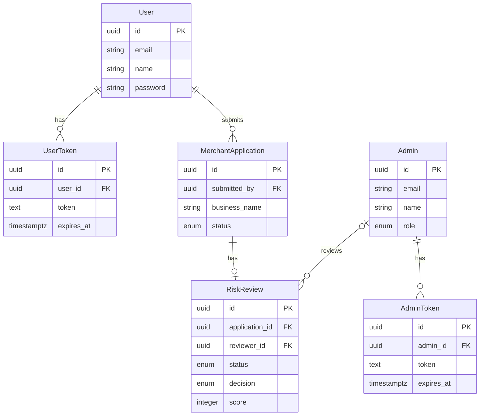

# Merchant Onboarding Platform

A backend application built with NestJS for managing merchant onboarding, application lifecycle, and risk review workflows. The platform provides role-based access control for administrators, reviewers, and sellers, with JWT authentication and object-level authorization.

It uses PostgreSQL with TypeORM for persistent data storage and Redis with BullMQ to process risk reviews asynchronously through a separate worker service. Docker Compose provides a consistent local development environment for the API, worker, database, and queue infrastructure.

## Prerequisites

Ensure the following tools are installed:

- **Docker Engine** and **Docker Compose** — to run the API, risk review worker, PostgreSQL, and Redis.
- **Git** — to clone the repository.
- **Node.js 22+** and **pnpm 10+** — required if running the application outside Docker.

### Technology Stack

- Node.js 22 and TypeScript
- NestJS 10+
- PostgreSQL 17
- TypeORM and database migrations
- Redis 7 and BullMQ
- JWT authentication
- Swagger / OpenAPI
- Docker and Docker Compose

## Getting Started

### 1. Clone the Repository

```bash
git clone <repository-url>
cd merchant-onboarding-platform
```

### 2. Configure Environment Variables

Create a `.env` file from the example configuration:

```bash
cp .env.example .env
```

Update `.env` with your environment-specific configuration.

```dotenv
PORT=3000

DATABASE_HOST=db
DATABASE_PORT=5432
DATABASE_USERNAME=postgres
DATABASE_PASSWORD=your_password
DATABASE_NAME=merchant_onboarding

NODE_ENV=development

REDIS_HOST=redis
REDIS_PORT=6379

CORS_ORIGINS=["https://example.com","https://admin.example.com"]

CLIENT_JWT_SCERET_KEY=replace_with_a_secure_client_secret
CLIENT_JWT_EXPIRES_IN=1h

ADMIN_JWT_SCERET_KEY=replace_with_a_secure_admin_secret
ADMIN_JWT_EXPIRES_IN=1h
```

**Important:** The values in `.env.example` are placeholders for demonstration purposes. Replace the secrets and credentials as appropriate for your environment. Do not commit your `.env` file or real credentials to version control.

> **⚠️ Warning:** When running through Docker Compose, the database and Redis hostnames are configured as `db` and `redis` respectively. The Compose configuration overrides these host values for the application containers.

### 3. Start the Application

Build the application images and start all services:

```bash
docker compose up --build -d
```

Docker Compose starts the following services:

| Service              | Purpose                                 |
| -------------------- | --------------------------------------- |
| `app-dev`            | NestJS merchant onboarding API          |
| `risk-review-worker` | Processes asynchronous risk review jobs |
| `migration`          | Runs database migrations and seeders    |
| `db`                 | PostgreSQL database                     |
| `redis`              | Redis queue backend for BullMQ          |

The API and worker wait for PostgreSQL, Redis, and the migration service to complete their required startup checks.

### 4. Verify the Services

Check the running containers:

```bash
docker compose ps
```

View application logs:

```bash
docker compose logs -f app-dev
```

View risk review worker logs:

```bash
docker compose logs -f risk-review-worker
```

View all service logs:

```bash
docker compose logs -f
```

### 5. Stop the Application

Stop and remove the running containers:

```bash
docker compose down
```

To remove the PostgreSQL and Redis volumes as well, use the following command. **This permanently deletes the persisted database and Redis data stored in those volumes.**

```bash
docker compose down -v
```

## Project Architecture

The project follows a modular monorepo architecture built with NestJS. It separates the merchant onboarding API, asynchronous risk review worker, shared libraries, and database layer into distinct applications and modules.

### Directory Structure

```text
apps/
├── merchant-onboarding-platform/
│   └── src/
│       ├── admin/
│       ├── auth/
│       ├── producer-listener/
│       ├── reviewer/
│       ├── seller/
│       └── seeder/
└── risk-review-worker/
    └── src/

libs/
├── common/
├── guards/
├── queue-contracts/
└── typeorm-source/
```

### Applications

**Swagger Documentation:** [http://localhost:3000/merchant-onboarding/api/](http://localhost:3000/merchant-onboarding/api/)

- **Merchant Onboarding API (`apps/merchant-onboarding-platform`)** — handles authentication, seller and administrator operations, merchant application management, reviewer workflows, and risk review job submission.
- **Risk Review Worker (`apps/risk-review-worker`)** — runs as a separate process to handle asynchronous risk review jobs submitted through BullMQ.

### Shared Libraries

- **`libs/common`** — shared enums, interfaces, messages, validation patterns, and error-handling utilities.
- **`libs/guards`** — authentication guards and role-based authorization components.
- **`libs/queue-contracts`** — shared queue names and queue configuration.
- **`libs/typeorm-source`** — TypeORM configuration, database entities, migrations, and database services.

### Infrastructure

Docker Compose coordinates the API, risk review worker, PostgreSQL database, Redis instance, and migration/seeding service. PostgreSQL provides persistent storage, while Redis supports BullMQ's asynchronous job queue.

The API and worker are built from the same Dockerfile but run as separate processes with different entry points.

## Database Schema

The application uses PostgreSQL with TypeORM to store and manage data. It contains six entities for users, admins, authentication tokens, merchant applications, and risk reviews.

### Entities and Responsibilities

| Entity                | Table                   | Description                                                                                 |
| --------------------- | ----------------------- | ------------------------------------------------------------------------------------------- |
| `User`                | `users`                 | Stores seller account details and their submitted applications and tokens.                  |
| `Admin`               | `admin`                 | Stores admin and reviewer account details, roles, and assigned reviews.                     |
| `UserToken`           | `user_tokens`           | Stores seller login tokens and their expiration times.                                      |
| `AdminToken`          | `admin_tokens`          | Stores admin login tokens and their expiration times.                                       |
| `MerchantApplication` | `merchant_applications` | Stores merchant business details, requested processing information, and application status. |
| `RiskReview`          | `risk_reviews`          | Stores review status, risk decisions, scores, reasons, and reviewer assignments.            |

### Entity Relationship Diagram

**Relationship notes:**

- A user can submit multiple applications.
- A user or admin can have multiple login tokens.
- An application can have at most one risk review.
- A risk review can exist before a reviewer is assigned.



**Note on Separate Token Tables:** The `user_tokens` and `admin_tokens` tables are kept separate because sellers and admins have different access contexts and permissions. This avoids storing both `user_id` and `admin_id` in one table, where one column would need to be `NULL` for every record. Separate tables also make token management, expiration, and revocation easier to handle independently for each user type.

### Demo Accounts and Database Seeding

The assignment requirements do not specify an API for creating seller, admin, or reviewer accounts. However, these accounts are necessary to demonstrate the platform's authentication, role-based access control, application management, and reviewer assignment workflows.

To make the application ready for evaluation, I implemented database seeders that create predefined demo accounts for all three roles.

#### Demo Admin and Reviewer Accounts

| Name         | Email                    | Password   | Role       |
| ------------ | ------------------------ | ---------- | ---------- |
| System Admin | `admin@gmail.com`        | `Demo@123` | `ADMIN`    |
| Reviewer One | `reviewer.one@gmail.com` | `Demo@123` | `REVIEWER` |
| Reviewer Two | `reviewer.two@gmail.com` | `Demo@123` | `REVIEWER` |

#### Demo Seller Accounts

| Name         | Email              | Password   |
| ------------ | ------------------ | ---------- |
| Alex Morgan  | `alex@gmail.com`   | `Demo@123` |
| Taylor Smith | `taylor@gmail.com` | `Demo@123` |
| Jordan Lee   | `jordan@gmail.com` | `Demo@123` |
| Casey Brown  | `casey@gmail.com`  | `Demo@123` |

#### Why Seed These Accounts?

- **Admin:** Demonstrates administrative operations and access to protected functionality(full operational access.).
- **Reviewers:** Demonstrate reviewer assignment and risk-review workflows.
- **Sellers:** Demonstrate seller authentication and merchant application creation and management.

The seeders run automatically as part of the Docker Compose startup process, after database migrations have completed. This makes the application ready for evaluation without requiring manual account creation.

These predefined credentials are intended for local demonstration and evaluation only, not production use.

### 1. Authentication APIs

These endpoints authenticate sellers, administrators, and reviewers using their email and password.

| Method | Endpoint            | Description                         |
| ------ | ------------------- | ----------------------------------- |
| `POST` | `/auth/login`       | Authenticates a seller.             |
| `POST` | `/auth/admin/login` | Authenticates an admin or reviewer. |

**Request Body:**

```json
{
  "email": "alex@gmail.com",
  "password": "Demo@123"
}
```

**Seller Login Response:**

```json
{
  "statusCode": 200,
  "success": true,
  "message": "Logged in successfully.",
  "data": {
    "userId": "895fa4b4-d9b6-4aa3-9960-980384ad224b",
    "name": "Alex Morgan",
    "email": "alex@gmail.com",
    "token": "Bearer <access_token>"
  }
}
```

**Admin Login Response:**

```json
{
  "statusCode": 200,
  "success": true,
  "message": "Logged in successfully.",
  "data": {
    "adminId": "00037340-5e68-477b-beae-17c524d8e2f7",
    "name": "System Admin",
    "email": "admin@gmail.com",
    "role": "ADMIN",
    "token": "Bearer <access_token>"
  }
}
```

### 2. Seller APIs

These endpoints allow authenticated sellers to create and manage their merchant applications. All endpoints require a valid seller JWT token.

#### Create Merchant Application

`POST /applications`

Creates a merchant application using the seller's business details.

**Request Body:**

```json
{
  "businessName": "Himalayan Coffee",
  "legalBusinessName": "Himalayan Coffee Private Limited",
  "businessType": "RETAIL",
  "ownerName": "Ram Sharma",
  "ownerEmail": "ram@example.com",
  "ownerPhone": "+9779812345678",
  "requestedProcessingVolume": "250000.00",
  "requestedTransactionType": "CARD_PAYMENT",
  "businessRegistrationNumber": "REG-123456",
  "businessWebsite": "https://himalayancoffee.com",
  "businessAddress": "Thamel, Kathmandu, Nepal",
  "taxIdentificationNumber": "PAN-123456789",
  "status": "DRAFT" |"SUBMITTED"
}
```

**Flow:**

- If the application is saved as `DRAFT`, it is not added to the risk-review queue.
- If submitted with status `SUBMITTED`, the API sends a risk-review job to Redis through BullMQ.
- The separate risk-review worker processes the job, calculates a risk score, and saves the result in the `risk_reviews` table.
- The risk review starts with status `PENDING`. The automated assessment result is stored, and the application can proceed through the reviewer workflow.

**Example Risk Review Result:**

```json
{
  "id": "60545b5b-16af-4467-80e7-e4a0de763253",
  "status": "PENDING",
  "decision": null,
  "score": 10,
  "reason": "Automated risk assessment completed.",
  "application_id": "4197fe27-b6fb-4f09-bbf5-13fc4fca404f",
  "reviewer_id": null,
  "provider_reference": "MOCK-KYB-508696a0-61d1-417a-a4ec-394f70c75d10",
  "admin_reason": null,
  "is_auto_analysis_completed": true
}
```

**Success Response:**

```json
{
  "statusCode": 200,
  "success": true,
  "message": "Application created successfully."
}
```

**Note on Asynchronous Risk Review:** Merchant onboarding typically involves multiple verification steps, such as business registration checks, tax verification, and KYB (Know Your Business) validation. These operations can take time, so a separate worker is used to process risk reviews asynchronously without blocking API requests.

For this assignment, the worker simulates the verification process by calculating a risk score and saving the result in the `risk_reviews` table. The review remains `PENDING` until an admin assigns a reviewer to complete the manual review and make a final decision.

#### Update Merchant Application

`PATCH /applications/:applicationId`

Allows a seller to update their own merchant application while its status is `DRAFT` or `REQUEST_INFORMATION`.

**Request Body:**

```json
{
  "businessName": "Himalayan Coffee",
  "legalBusinessName": "Himalayan Coffee Private Limited",
  "businessType": "RETAIL",
  "ownerName": "Ram Sharma",
  "ownerEmail": "ram@example.com",
  "ownerPhone": "+9779812345678",
  "requestedProcessingVolume": "250000.00",
  "requestedTransactionType": "CARD_PAYMENT",
  "businessRegistrationNumber": "REG-123456",
  "businessWebsite": "https://himalayancoffee.com",
  "businessAddress": "Thamel, Kathmandu, Nepal",
  "taxIdentificationNumber": "PAN-123456789",
  "status": "SUBMITTED" | "DRAFT"
}
```

**Flow:**

- Verifies that the application belongs to the authenticated seller.
- Allows updates only when the application is in `DRAFT` or `REQUEST_INFORMATION` status.
- If the status is changed to `SUBMITTED`, the application is added to the risk-review queue for asynchronous processing.

**Success Response:**

```json
{
  "statusCode": 200,
  "success": true,
  "message": "Application updated successfully."
}
```

**Error Responses:**

- `403 Forbidden` — The application is not editable in its current status.
- `404 Not Found` — The application does not exist or does not belong to the seller.

**Note:** `REQUEST_INFORMATION` is set by the platform admin or assigned reviewer when an application requires additional documents or valid information to continue the review. The seller can then update the application with the requested information and resubmit it for review.

#### Get My Merchant Applications

`GET /applications`

Retrieves the authenticated seller's merchant applications with pagination and their associated risk-review details.

**Flow:**

- Uses the authenticated seller's ID to retrieve only their own applications, enforcing **object-level authorization**.
- Supports pagination using `page` and `limit`.
- Returns applications from newest to oldest, including their relevant risk-review details.
- Selects only the required fields instead of returning every database column, helping avoid unnecessary data exposure.

**Response Metadata:**

```json
{
  "statusCode": 200,
  "success": true,
  "message": "Application fetch successfully.",
   "data":[]
  "metadata": {
    "total": 10,
    "page": 1,
    "limit": 10,
    "totalPages": 1
  }
}
```

**Design Note:** I considered which fields should be returned rather than exposing the entire entity. For this implementation, I selected the fields needed by the seller, including relevant risk-review information. This keeps the response focused and reduces unnecessary data exposure while leaving room to refine response fields based on future client requirements.

### 3. System Admin APIs

These endpoints allow system administrators to manage and review merchant applications. Access is restricted to users with the `ADMIN` role through authentication and role-based authorization guards.

#### Get All Merchant Applications

`GET /admin/applications`

Retrieves all merchant applications with pagination and their associated risk-review details.

**Flow:**

- Requires a valid admin JWT and the `ADMIN` role.
- Retrieves applications across all sellers, unlike the seller endpoint, which returns only the authenticated seller's applications.
- Supports pagination using `page` and `limit`.
- Returns applications from newest to oldest, including relevant risk-review details.
- Selects only the required fields to avoid exposing unnecessary database information.

**Example Request:**

```bash
curl -X GET \
  'http://localhost:3000/merchant-onboarding/api/admin/applications?page=1&limit=10' \
  -H 'Authorization: Bearer <admin_access_token>'
```

**Response Metadata:**

```json
{
  "statusCode": 200,
  "success": true,
  "message": "Merchant applications retrieved successfully.",
  "data": [],
  "metadata": {
    "total": 10,
    "page": 1,
    "limit": 10,
    "totalPages": 1
  }
}
```

**Authorization Note:** Only system administrators can access this endpoint. Reviewers and sellers are denied access by the role-based authorization guard.

#### Get All Reviewers

`GET /admin/reviewers`

Retrieves all users with the `REVIEWER` role so the system admin can select a reviewer when assigning a merchant application's risk review.

**Flow:**

- Requires a valid admin JWT and the `ADMIN` role.
- Retrieves only accounts with the `REVIEWER` role.
- Supports pagination using `page` and `limit`.
- The system admin can use the returned reviewers to assign applications for risk review.

**Example Request:**

```bash
curl -X GET \
  'http://localhost:3000/merchant-onboarding/api/admin/reviewers?page=1&limit=10' \
  -H 'Authorization: Bearer <admin_access_token>'
```

**Success Response:**

```json
{
  "statusCode": 200,
  "success": true,
  "message": "Reviewers retrieved successfully.",
  "data": [],
  "metadata": {
    "total": 2,
    "page": 1,
    "limit": 10,
    "totalPages": 1
  }
}
```
#### Assign Reviewer to Merchant Application

`PATCH /admin/applications/assign-reviewer`

Assigns a reviewer to a merchant application's risk review. Only the system admin can perform this operation.

**Request Body:**

```json
{
  "applicationId": "550e8400-e29b-41d4-a716-446655440001",
  "reviewerId": "550e8400-e29b-41d4-a716-446655440000"
}
```

**Flow:**

- Verifies that the application has a risk-review record and that the selected reviewer exists.
- Assigns the reviewer to the risk review.
- Updates the risk-review status from `PENDING` to `PROCESSING`.
- Updates the application status from `SUBMITTED` to `UNDER_REVIEW`.
- Performs these database changes within a single transaction, ensuring that both status updates succeed together or are rolled back if an operation fails.

**Success Response:**

```json
{
  "statusCode": 200,
  "success": true,
  "message": "Reviewer assigned successfully.",
  "data": null
}
```

**Why This API Matters:** It connects automated risk assessment with manual review. After the background worker calculates and stores the initial risk score, the system admin assigns a reviewer to examine the application and make the final risk decision.

**Error Responses:**

- `400 Bad Request` — Invalid request body or UUID format.
- `401 Unauthorized` — Missing or invalid authentication.
- `403 Forbidden` — The user does not have the required admin role.
- `404 Not Found` — The application has no matching risk-review record or the reviewer does not exist.

### 4. Reviewer APIs

#### Get Assigned Risk Reviews

`GET /reviewer/applications`

Retrieves risk reviews along with their associated merchant application details.

**Query Parameters:**

| Parameter | Description | Default |
|---|---|---|
| `page` | Page number | `1` |
| `limit` | Number of records per page | `10` |

**Flow:**

- Requires authentication through the admin authentication guard.
- Reviewers can access only risk reviews assigned to them.
- System admins can access all risk reviews.
- Includes relevant merchant application details and risk assessment results.
- Returns the newest risk reviews first.
- Supports pagination and returns pagination metadata.

**Example Request:**

`GET /reviewer/applications?page=1&limit=10`

**Success Response:**

```json
{
  "statusCode": 200,
  "success": true,
  "message": "Reviewer applications retrieved successfully.",
  "data": [],
  "metadata": {
    "total": 0,
    "page": 1,
    "limit": 10,
    "totalPages": 0
  }
}
```

**Authorization Note:** System admins can access all risk reviews, while reviewers can access only reviews assigned to them. This is enforced through role-based authorization and query filtering.

#### Perform Risk Decision

`PATCH /reviewer/applications/risk-decision`

Allows reviewers to submit risk decisions for applications assigned to them. System admins can make decisions on any application.

**Request Body:**

```json
{
  "applicationId": "<application-uuid>",
  "action": "APPROVED",
  "reason": "All required information has been verified."
}
```

**Supported Actions:**

| Action | Risk Decision | Application Status | Reason |
|---|---|---|---|
| `APPROVED` | `PASS` | `APPROVED` | Not required |
| `REJECTED` | `FAIL` | `REJECTED` | Required |
| `REQUEST_INFORMATION` | `FAIL` | `REQUEST_INFORMATION` | Required |

**Flow:**

- Requires authentication through the admin authentication guard.
- Reviewers can make decisions only on applications assigned to them. System admins can make decisions on any application.
- Verifies that a risk review exists and, for reviewers, that the application is assigned to them.
- Updates the risk review with the decision, reason, and `COMPLETED` status.
- Updates the merchant application's status based on the selected action.
- Executes both updates within a database transaction to ensure they succeed together or roll back together.
- When a system admin makes the decision, the admin is also assigned as the reviewer on the risk review record.

**Success Response:**

```json
{
  "statusCode": 200,
  "success": true,
  "message": "Risk decision performed successfully."
}
```

**Error Responses:**

- `401 Unauthorized` — Authentication is missing or invalid.
- `403 Forbidden` — The requester does not have permission to perform the action.
- `404 Not Found` — No matching risk review exists, or the application is not assigned to the requesting reviewer.

**Important:** When `REQUEST_INFORMATION` is selected, the risk review is marked as `FAIL` and `COMPLETED`, while the merchant application moves to `REQUEST_INFORMATION`. The seller can then provide the requested information and resubmit the application.


